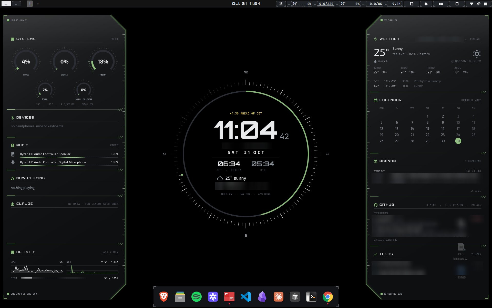
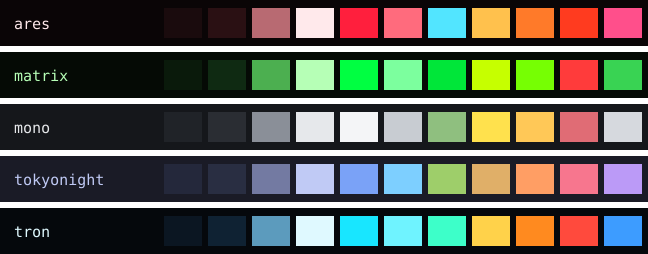
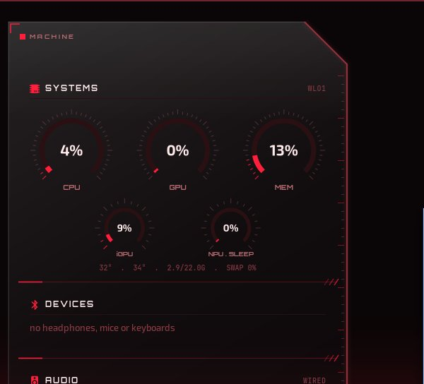
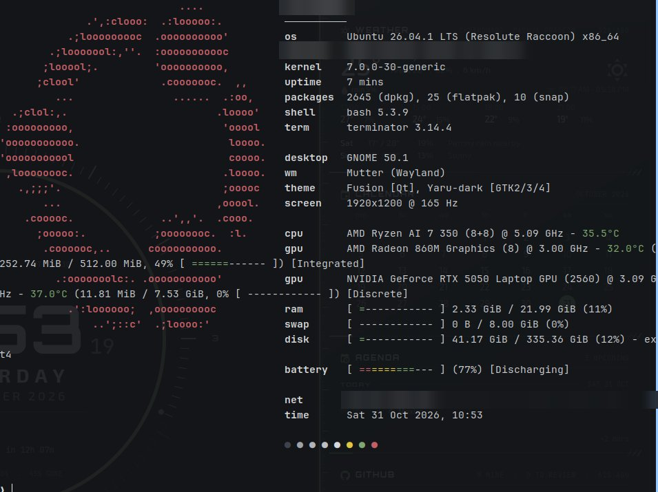
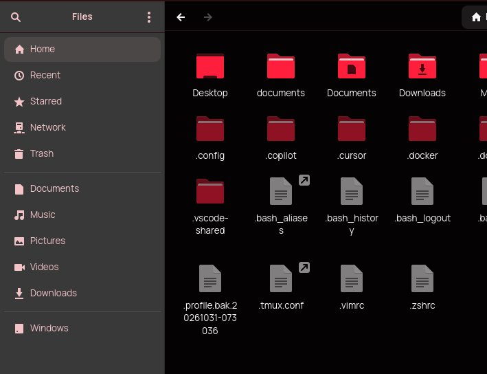

# dotfiles



A modular Ubuntu desktop and terminal setup: themed GNOME (five colour palettes), conky
instrument panels, browser theming, shell, git, tmux, editors and dev tools. You pick a
preset, a colour theme and the modules you want; everything else is left alone.

Works on Ubuntu 26.04 (GNOME 50), Ubuntu 24.04 and Zorin OS 18. Release-specific bits are
detected at run time.

Personal data (ssh hosts, git identity, robot IPs, work aliases, skills) lives in a separate
private repo mounted at `private/`. Without access to it everything still works, with
placeholders in its place. See [Private layer](#private-layer).

## Contents

1. [Quick start](#quick-start)
2. [What the first run asks](#what-the-first-run-asks)
3. [Presets](#presets)
4. [Colour themes](#colour-themes)
5. [Modules](#modules)
6. [Everyday use](#everyday-use)
7. [Private layer](#private-layer)
8. [How it works](#how-it-works)
9. [Troubleshooting](#troubleshooting)

## Quick start

### Anyone (public clone)

```bash
sudo apt install -y git gh fzf
git clone https://github.com/Pana1v/public-dotfiles ~/dotfiles
cd ~/dotfiles
./bootstrap.sh --dry-run          # optional: see every action, change nothing
./bootstrap.sh                    # pick preset, modules, theme; then it applies
```

You will be asked for your sudo password once. After the run, set your git name and email in
`~/.config/git/identity.gitconfig` and your ssh hosts in `~/.ssh/config`.

### Owner (with the private repo)

```bash
sudo apt install -y git gh fzf
gh auth login                     # as Pana1v: reads public-dotfiles and dotfiles-private
git clone --recurse-submodules https://github.com/Pana1v/public-dotfiles ~/Documents/repositories/dotfiles
cd ~/Documents/repositories/dotfiles
./bootstrap.sh --preset professional --theme tron     # or plain ./bootstrap.sh for pickers
```

Forgot `--recurse-submodules`? `bootstrap.sh` fetches `private/` by itself when your gh login
can read it. To also pull `claude-config` (owned by Pan-Navigator), run `gh auth login` a
second time as that account before applying the `claude` module.

Then move what never goes through git by hand: `~/.ssh/id_ed25519`, the values in
`~/.config/secrets/*.env`, and log in again to gh, Claude, Tailscale.

## What the first run asks

`./bootstrap.sh` with no flags walks through four pickers (fzf: arrows to move, TAB to tick,
ENTER to confirm, ESC to skip):

| Step | Question | Saved as |
|---|---|---|
| 1 | Preset: what kind of machine is this | `PRESET`, `PROFILE`, `CONKY_WIDGETS` |
| 2 | Modules: the preset's modules start ticked, adjust freely | not saved |
| 3 | Colour theme, with a live swatch preview (only when `rice` is ticked) | `RICE_THEME` |
| 4 | Lock-screen video: `grid` or `rain` (only with `rice`) | `RICE_LOCKSCREEN` |
| 5 | Packages: tick the apt, snap and flatpak packages to install. Nothing is preselected | not saved |

Answers go to `~/.config/dotfiles/local.env` (per machine, never in the repo), so later runs
skip steps 1, 3 and 4. Run `./bootstrap.sh --setup` to be asked again, or edit the file.

## Presets

| Preset | For | Profile | Conky | Modules |
|---|---|---|---|---|
| `personal` | your own laptop | Google Tasks shown | wings only | full desktop + Obsidian + vid2gif |
| `professional` | a work machine | Google Tasks hidden and not fetched | wings + ops deck (fleet, Linear) | full desktop |
| `minimal` | servers, VMs, someone else's desktop | | none | shell, git, tmux, ssh, CLI and dev tools; desktop untouched |

```bash
./bootstrap.sh --preset personal          # that preset's modules, no module picker
./bootstrap.sh --list                     # every module, preset and theme
```

A preset is a small file in `presets/`. Copy one to make your own: `DESC`, `PROFILE`,
`CONKY_WIDGETS` and `MODULES` (space separated).

## Colour themes

One palette recolours the whole desktop: GTK, GNOME Shell, icons, cursor, wallpaper, terminals
(kitty, Terminator, Ptyxis), tmux, starship, fzf, btop, rofi, Qt apps, VS Code, Obsidian,
Claude Code, conky, lock and login screens, and every browser.

| Theme | Look |
|---|---|
| `ares` | black and red glow, cyan for good states |
| `matrix` | phosphor green on black |
| `mono` | greyscale, colour only for state |
| `tokyonight` | deep navy with soft blue and purple |
| `tron` | near-black blue, cyan, orange for warnings |



| Tron | Ares |
|---|---|
|  |  |
|  |  |

Screenshots have personal details (names, places, repos, addresses) blurred.
`lib/palette-svg.py` redraws the palette strip after a palette changes.

```bash
./bootstrap.sh --theme matrix --only rice    # choose and apply in one go
modules/rice/switch-theme.sh matrix          # switch live on a riced machine
modules/rice/revert.sh                       # undo the rice
```

Palettes are `modules/rice/themes/<name>.palette`, one `role #hex` per line.

## Modules

| Module | What it does |
|---|---|
| apt-repos | third-party apt sources and keys: Brave, Claude Desktop, Cursor, Docker, Foxglove, gh, nvidia toolkit, Tailscale, VS Code, fastfetch |
| apps-dev | build tools, docker, tmux, fzf, rg, uv, nvm + node, rustup, Claude Code |
| apps-desktop | Brave, Foxglove, VS Code, Cursor, terminals, snaps and flatpaks (Spotify, OBS, ...) |
| browsers | themes every browser in the active palette and sets the start page; see below |
| claude | Claude Code status line (feeds the conky Claude panel), optional `claude-config` repo |
| cli-tools | atuin, eza, bat, fd, delta, zoxide, lazygit, yazi, direnv, tealdeer, dust, duf, just, hyperfine, watchexec |
| conky | glass instrument wings around a centre clock: system, devices, audio, now playing, Claude usage, weather, calendar, agenda, GitHub PRs, Google Tasks; ops deck with fleet and Linear |
| cursor | Cursor settings, rules (`.mdc`), mcp.json, extensions |
| fonts-cursors | Manrope, Nerd Symbols, Roboto, JetBrains Mono, oreo-pink cursor |
| git | gitconfig (gh credential helper, lfs, delta) and global gitignore; identity from the private layer |
| gnome | dconf settings: theme, keybindings, taskbar, extension prefs, terminal profile, wallpaper |
| gnome-extensions | user extensions (spotify-deck, sysmon-flair, term-landscape, ...) and enabled list |
| obsidian | Obsidian flatpak, clones your vault (`OBSIDIAN_REPO`), fills missing `.obsidian` config |
| rice | the themed desktop described in [Colour themes](#colour-themes), plus pop-shell tiling |
| secrets | `~/.config/secrets/*.env` from templates, mode 600; fill values by hand |
| shell | bashrc, bash_aliases, profile, inputrc |
| skills | Claude and Cursor skills from the private layer, linked into both tools |
| ssh | `~/.ssh/config` from the private layer (example config otherwise). No keys |
| terminator | Terminator config, plugins (clickable Linear keys, VS Code paths), default terminal |
| tmux | tmux.conf (mouse, 50k scrollback) |
| vid2gif | GTK4 video trimmer: clones Pana1v/vid2gif, launcher, gtk4 GStreamer sink |
| vscode | VS Code settings, mcp.json, extensions |

**Browsers.** Chrome, Brave, Chromium, Edge and Vivaldi (every profile) get dark mode with the
theme colour seeded from the palette accent. Firefox, LibreWolf and Zen get a generated
`userChrome.css` and `userContent.css` (toolbar, tabs, menus, new tab page) plus a marked block
in `user.js`. All get the palette start page as home.

The new tab page shows the palette wallpaper (or a solid fill for colour-only palettes):

| Browser | New tab |
|---|---|
| Chrome, Chromium | wallpaper as the custom background, toolbar tinted from the accent |
| Brave | wallpaper as a custom image; sponsored images off. Your own uploaded images are kept |
| Firefox, LibreWolf, Zen | wallpaper behind search and shortcuts, both in palette colours; sponsored stories off |
| Edge, Vivaldi | own new tab page, colours only |

The start page (home button and startup) uses the same wallpaper. Deb, flatpak and snap installs are all found. Close a browser before
applying, or it overwrites the change on exit; the module tells you which ones were open.
`switch-theme.sh` re-runs it so browsers follow a theme change.

**Conky widgets** are a per-machine choice: `CONKY_WIDGETS` in `local.env` (set by the
preset). `GITHUB_USER=<login>` picks whose PRs show.

## Everyday use

| Task | Command |
|---|---|
| Apply one module again | `./bootstrap.sh --only rice` |
| Everything, no pickers | `./apply-all.sh` (accepts `--preset`, `--theme`, `--dry-run`) |
| Re-pick preset and theme | `./bootstrap.sh --setup` |
| Push this machine's changes | `./sync.sh` (or `./sync.sh -m "rice: brighter accent"`) |
| Get changes from another machine | `./sync.sh --pull`, then re-apply what changed |
| Only refresh copied state | `./snapshot.sh && git diff --stat` |

`sync.sh` runs `snapshot.sh`, shows what changed in both repos, asks, then commits and pushes
the private repo first and the public one second, so the public repo never points at a private
commit that is not on GitHub.

## Private layer

`private/` is a git submodule pointing at `Pana1v/dotfiles-private`, readable only by its
owner. A public clone has an empty `private/` and nothing breaks.

| Private file | Public fallback |
|---|---|
| `ssh/config` | `modules/ssh/files/config.example` |
| `git/identity.gitconfig` | `modules/git/files/identity.example.gitconfig`, copied for you to edit |
| `conky/fleet-hosts.tsv` | no fleet hosts; or your own `~/.config/dotfiles/fleet-hosts.tsv` |
| `gnome/dconf/*.ini` (paired phone, weather location) | not loaded |
| `shell/bashrc.private` (work aliases) | not sourced |
| `skills/` | `skills` module does nothing |
| `private.env` (vault, claude-config, Linear workspace) | same keys in `local.env`, or unset |

Settings are looked up in this order: environment, `~/.config/dotfiles/local.env`,
`private/private.env`. So anyone can set `OBSIDIAN_REPO` or `LINEAR_WORKSPACE` in `local.env`.

**Keeping private things private.** `snapshot.sh` routes private dconf sections
(`modules/gnome/private-sections.txt`) into `private/`. A pre-commit hook (installed by
`bootstrap.sh`) and `sync.sh` run `lib/leak-check.sh`, which refuses any public commit that
adds a value listed in `private/leak-patterns.txt`. Check the whole tree with
`lib/leak-check.sh --tree`.

**Skills.** `private/skills/<name>/SKILL.md` is the source. Each skill is symlinked into
`~/.claude/skills/` and `~/.cursor/skills/`, so an edit from either tool lands in the private
repo. Skills that claude.ai already syncs into `~/.claude/skills/synced/` are not linked a
second time for Claude. `snapshot.sh` copies those synced skills back into `private/skills/`.

## How it works

```
symlink   repo <── $HOME        edit either side, change is already in the repo
copy      repo ──> $HOME        program rewrites the files, or they live in another git repo
snapshot  repo <── machine      ./snapshot.sh re-exports what copy modules cannot track
```

A run: one sudo prompt, `apt-repos`, every ticked package in one apt pass (snaps and flatpaks
download alongside), then modules in parallel. A module starts once its `DEPENDS`
(`module.env`) are done; modules sharing a `LOCKS` name never run together. Each module's
output prints as one block when it finishes. Every replaced file is moved to
`<file>.bak.<timestamp>`, never deleted. Re-running is safe: finished steps print `ok`.

Off Zorin, Zorin-only pieces are swapped for the stand-ins in `zorin-deps.txt` (Yaru themes,
Ubuntu's dock, GSConnect, ...). Extensions that do not list the running GNOME version stay off
and are named in the output.

Adding a module: `modules/<name>/module.env` (`DESC`, `DEPENDS`, optional `LOCKS`), an
`apply.sh` that sources `lib/common.sh`, and optional `packages.{apt,snap,flatpak}`. Use
`link_file`, `copy_tree`, `run` and `conf_get` from `lib/common.sh`.

## Troubleshooting

| Symptom | Fix |
|---|---|
| `private repo not readable from this account` | `gh auth login` as the owner, then `git submodule update --init private` |
| Browser did not change colour | it was open during apply: close it, `./bootstrap.sh --only browsers` |
| `the package picker needs a terminal` | run in a terminal, or add `--all-packages` |
| A module failed | `./bootstrap.sh --serial --only <module>` for live output |
| Wrong theme after login | check `RICE_THEME` in `~/.config/dotfiles/local.env`, then `--only rice` |
| leak-check refused a commit | move the value into `private/`, or add a fallback that reads it with `conf_get` |

Not covered: heavy installs (driftwm, Gazebo, Isaac Sim, TinyTeX, Docker images), robotics
hardware tools, AppImages, and anything work-managed (CrowdStrike, Cloudflare WARP).
