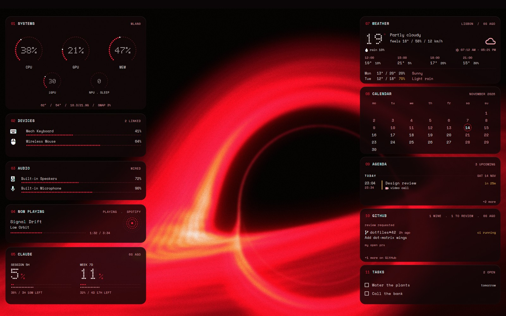

# dotfiles



Modular Ubuntu GNOME rice: themed shell, terminals, editors, browsers and dot-matrix conky widgets.

Docs for every module and tool: <https://pana1v.github.io/public-dotfiles/>.

```bash
git clone https://github.com/Pana1v/public-dotfiles ~/dotfiles && ~/dotfiles/bootstrap.sh
```
