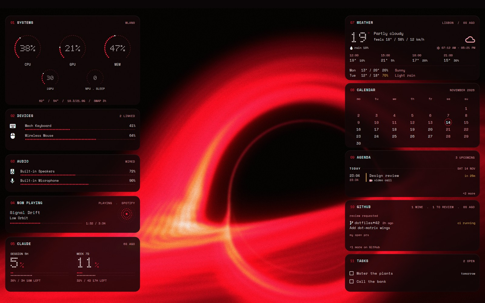

# public-dotfiles

Modular Ubuntu GNOME rice: themed shell, terminals, editors, browsers and dot-matrix conky widgets.



## Install

```bash
git clone https://github.com/Pana1v/public-dotfiles ~/dotfiles
~/dotfiles/bootstrap.sh
```

`bootstrap.sh` asks for a preset, the modules (the preset's are ticked) and a colour theme, then applies them.

| Command | Does |
|---|---|
| `./bootstrap.sh` | Pickers: preset, modules, theme |
| `./bootstrap.sh --preset professional --theme blood` | No pickers |
| `./bootstrap.sh --only conky,tmux` | Just those modules (plus their dependencies) |
| `./bootstrap.sh --list` | Modules, presets and themes |
| `./bootstrap.sh --dry-run ...` | Print actions, change nothing |
| `./apply-all.sh` | Every module and package, no pickers |
| `./modules/rice/switch-theme.sh <palette>` | Recolour the whole desktop |

Choices are saved to `~/.config/dotfiles/local.env`, so later runs do not ask again.

!!! note "Private layer"
    `private/` is a git submodule with personal config (ssh hosts, skills, fleet list).
    A clone without access gets the public examples instead; nothing private is in this repo or these docs.

## Where things are

| Page | Covers |
|---|---|
| [Modules](modules.md) | Every module and preset |
| [Themes](themes.md) | Palettes, roles, `switch-theme.sh` |
| [Conky widgets](conky.md) | The wings, decks and cards |
| [Rofi](rofi.md) | Launcher modes: apps, calc, bots, emoji, time, grab |
| [GNOME extensions](gnome-extensions.md) | Top bar, music pill, clipboard, system monitor |
| [Terminal](terminal.md) | Terminator, kitty, tmux, prompt, CLI tools |
| [Browsers and apps](browsers-apps.md) | Chrome, Edge, Firefox, VS Code, Spotify, Qt |
| [mk-please](mk-please.md) | Serve any markdown folder as a live site in the rice palette |
| [Docs site](docs-site.md) | Reading and editing these docs locally |
